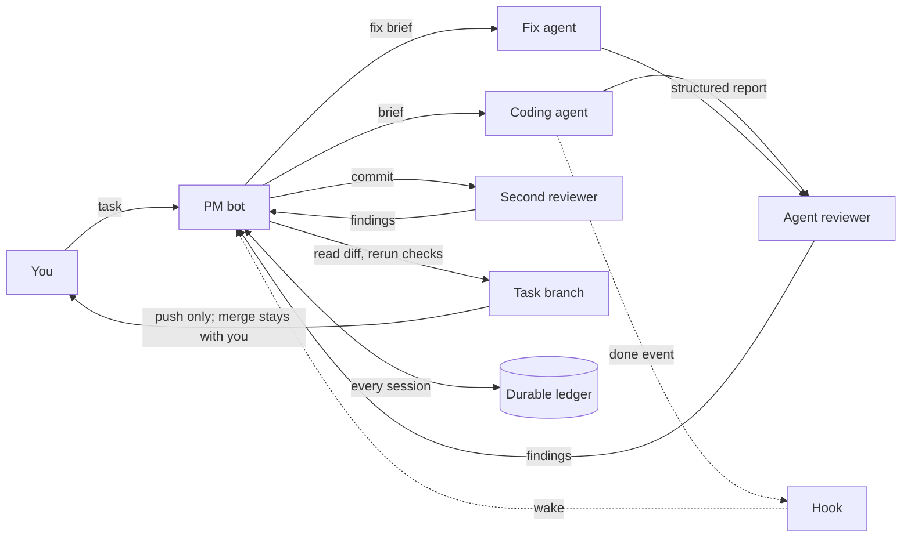

# pm-steward

**A project manager that lives in a chatbot like Muse.** It automates project management for you: planning, dispatching coding agents, keeping the ledger, and reviewing the work before anything ships.

No dashboard, no ticket board, and no CLI for daily work. The interface is a conversation with a bot that stays on duty between messages.

---

## Why this exists

A chat is a stateless interface. A bot that manages real work has to survive four failures of chat:

| Failure | What the workflow does about it |
|---|---|
| It forgets | Task state lives in a durable ledger, re-injected at the start of every session — never in the scrollback |
| It cannot see a terminal | Work is dispatched as a brief written to a file; the worker answers with a structured report |
| It cannot poll reliably | Completion is pushed back as a wake event; the bot reacts instead of sleeping in a loop |
| It will believe an agent's self-report | The PM reads the diff and reruns the checks itself before accepting anything |

Once those four are solved, project management in a chat stops being a demo and starts being a way to ship.

## The loop

The gate order is fixed: implement, agent review by a different model family, commit, second review, fix rounds, acceptance, push, report.

Hard boundaries:

- never pushes to `main` or any protected branch
- no force-push, no deletion of remote branches or tags
- never pushes secrets, unverified commits, or unreviewed work
- on a non-fast-forward rejection it stops and reports; no automatic pull, rebase, or retry
- never merges, releases, or sends anything external — those stay with the human
- never accepts a worker's own claim of success
- never reuses a task id

## What you need

Most necessary first:

| Capability | Reference implementation | Acceptable substitute |
|---|---|---|
| Bot host: persistent conversation, background wake, scheduled jobs | Muse | any bot runtime with hooks and cron |
| Durable ledger, re-injected into context at every session start | Goals | Linear, Notion, SQLite, plus a rule that the bot reads them first |
| Remote dispatch to a worker machine | SSH + `nohup` + log files | Tailscale + SSH, container exec, cloud job API |
| Completion signal that wakes the conversation | ntfy + per-task hook | webhook, queue, chat message |
| Independent review by another model family | a reviewer run through a different provider | a human reviewer |

Two stores, not one: the **ledger** holds what to do and how far each gate has progressed; the **event pool** holds `started` / `done` records plus the dispatch registry (host, log path). The worker needs outbound access to the completion channel, not just inbound SSH.

Everything else — model routing tables, browser-based static review, tunnels — is optional. The smallest working setup will be documented in `MINIMUM.md` (planned).

## How the tools compose

This is not a script collection. It is a set of stages, each needing specific tools wired together. The full matrix lives in `COMPOSITION.md` (planned); the short version:

| Stage | Tools | Their job |
|---|---|---|
| Plan | bot + project rules | read the project's own rules before splitting work |
| Choose a model | routing table + runner profiles | pick by role, not by habit; the reviewer must not share a model family with the implementer |
| Dispatch | SSH + dispatch script + wrapper + worker CLI | build the wake hook, launch detached, record host and log path |
| Monitor | wrapper fingerprint loop + push channel | remind, never kill |
| Review | a different model family + a second reviewer | structured summary; findings triaged by ownership and probability |
| Accept | PM + git | rerun the checks, then push the task branch only |

## Status

Early. The rules, workflows, and templates are in place; the adapters and the minimum working path are not. There is no runnable code in this repo yet.

Read next: `GLOSSARY.md`, `pm-role.md`, `core/AGENTS.md`, `workflows/`, `templates/`.

Next: `STACK.md` and `COMPOSITION.md` — the capability map and the stage-by-tool map — then one adapter per tool, starting with the host contract (`adapters/muse.md`).

Muse is the reference host, not a dependency. Any runtime exposing the same five interfaces — persistent conversation, wake, hook-log, cron, remote shell — can replace it.

## Layout

- `core/AGENTS.md` — the standing rules, R01 to R34
- `pm-role.md`, `GLOSSARY.md` — the role and the vocabulary
- `workflows/` — one file per task shape, plus a template for new ones
- `templates/` — the brief and the report formats
- `adapters/` — one file per tool (planned)
- `docs/plans/` — how this package is assembled

## License

MIT. See [LICENSE](LICENSE).
