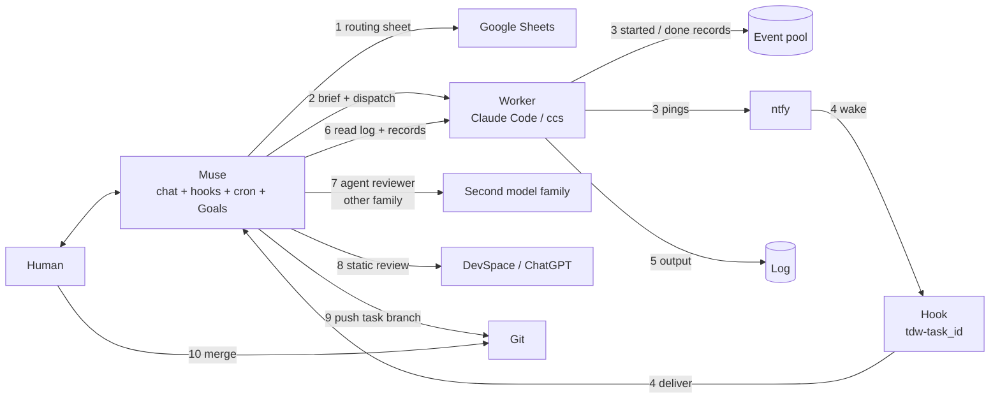

# A Muse build

One concrete, opinionated combination that is known to run, with Muse as the chat bot. The contracts live in `adapters/`; this page is the bill of materials and the wiring order for one host.

Version 1, 2026-10-25. Muse's own settings change between releases; check the interfaces against your version. The composition is the part meant to last.

## Shape

Muse holds the conversation, the wake, the schedule, and the ledger. Everything else runs somewhere else:

- the worker is a separate machine; the PM never executes work there and the worker never talks to the human
- the event pool and the log live on the worker; the registry lives with the PM
- the routing table is a file a human can edit without a commit
- the second reviewer is a separate browser session, not another runner on the same machine

## Two layers of state

Both layers use the word "task"; they hold different objects and must not be substituted for each other.

| Question | Store | Fields | Written by |
|---|---|---|---|
| How far has the PM task moved? | Goals assistant tracking items | gate checklist (`✓` / `→` / `□`), `current_state`, evidence timeline | the PM only |
| Did the worker run finish, and how? | event pool + worker log + hook receipts | task_id, started/done, exit_code, log growth | wrapper, hook, PM (receipt) |

A `done` wake does not move the ledger. The pool does not know about acceptance, push, or the next gate. Reading one and calling it status is the most common way to report a state that is wrong.

## Bill of materials

| Layer | Tool | What it does here | Config | Adapter |
|---|---|---|---|---|
| Host | Muse | Conversation, wake, hook log/silent, cron, side chat, connectors | `PM_HOOK_RUNTIME`, `PM_HOOK_CREATE_CMD` | `adapters/muse.md` |
| Ledger | Goals (assistant tracking items) | One entry per PM task: gate checklist, current pulse, evidence timeline; injected at session start | host feature | `adapters/ledger.md` |
| Dispatch | SSH + `nohup` + wrapper | Detached launch, log, PID, registry entry | `PM_WORKER_*`, `PM_SSH_OPTS` | `adapters/ssh.md` |
| Reachability | Cloudflare Tunnel + Access | Reach a worker with no public address; optionally expose ntfy | `PM_SSH_OPTS`, `PM_CLOUDFLARED_BIN` | `adapters/cloudflare-tunnel.md` |
| Runner | Claude Code via ccs profiles | Executes the brief, edits, tests, stops at the turn limit | `PM_RUNNER_CMD`, `PM_WORKER_PATH` | `adapters/ccs.md` |
| Model endpoint | CLIProxyAPI | OpenAI-compatible endpoint; profile per upstream | worker profile files | `adapters/cliproxyapi.md` |
| Completion | ntfy + per-task hook | `started` / `done` / `check` / `progress` pings, then a wake | `PM_NOTIFY_*` | `adapters/ntfy.md` |
| Routing | Google Sheets | Role, model, priority, status, provider, context window | `PM_MODEL_ROUTING_*` | `adapters/google-sheets.md` |
| Second reviewer | ChatGPT web via DevSpace | Static review of the committed branch | per-task ledger note | `adapters/devspace.md` |
| Backlog | GitHub issues | Out-of-scope findings, not mixed into the diff | — | — |

## Wiring

## One task, end to end

1. **Ask.** The human states the task in Muse. Muse opens a Goals entry with the checklist and the gate order (R16).
2. **Choose.** Muse reads the routing sheet live and picks a coding profile and a reviewer from a different family (R28). A failed read stops the dispatch.
3. **Dispatch.** Muse writes the brief from `templates/brief.md`, creates the `tdw-<task_id>` hook and verifies it (R27), then runs `bin/dispatch.sh` over SSH, through the tunnel when needed (R21).
4. **Execute.** On the worker, the wrapper writes `started`, runs `ccs` with the brief on stdin, and monitors log size and worktree fingerprint. It reminds on a stall; it never kills (R21).
5. **Signal.** The wrapper writes `done` and sends the ping. ntfy carries it to the hook, which turns it into a wake in the conversation that started the task (R22).
6. **Wake.** Muse writes the receipt, reads the log at the registry's `log` path (R23), and continues the loop. If no wake arrives, the hourly sweep finds the `done` record (R17).
7. **Review.** A different agent, from the other model family, reads the diff and returns the eight-field summary (R06, R07).
8. **Second review.** Muse commits locally, then sends the branch to the DevSpace workspace for static review. Findings are triaged by ownership, then probability (R16, R31).
9. **Fix.** Each fix round uses a fresh agent with the full context merged into the brief (R30).
10. **Accept and push.** Muse reads the diff, reruns the checks itself, and pushes the task branch only (R18). The human merges.

## Muse settings that matter

| Setting | Why it matters | What breaks without it |
|---|---|---|
| Hook runtime shim (`wake`, `log`, `silent`, per-hook state, disable) | The hook is the only path from a completion to the conversation | No wake, or a shared cursor that makes two tasks steal events |
| Delivery pinned to the originating chat at hook creation | The result must reach the window that asked | The wake lands in a side panel and nobody acts on it |
| Cron for the sweep | Recovers a lost ping or a hook that never got created | A finished task sits unclaimed until someone looks |
| Goals assistant tracking items injected at session start | The book survives compaction and a runtime change; separate from the user's personal goals | The bot answers from chat memory and reports a stale state |
| Connectors or a shell that can reach the worker | Dispatch and the tunnel both depend on it | `ssh` works in a terminal but fails inside the hook |
| Side chat (optional) | Long work does not block the main thread | The PM is unavailable while a task runs |

## Configuration

Copy `config/pm.env.example` and fill these groups:

| Group | Variables | Check |
|---|---|---|
| Worker | `PM_WORKER_SSH_TARGET`, `PM_WORKER_PATH`, `PM_WORKER_SPOOL_DIR`, `PM_WORKER_LOG_DIR`, `PM_WORKER_WRAPPER_DIR` | `ssh <target> 'command -v <runner>'` |
| Runner | `PM_RUNNER_CMD` | one simple command, no shell metacharacters |
| State | `PM_STATE_DIR`, `PM_REGISTRY_DIR`, `PM_TASK_DIR`, `PM_RECEIPTS` | directories writable |
| Completion | `PM_NOTIFY_URL`, `PM_NOTIFY_TOPIC`, `PM_NOTIFY_NETRC` | publish and poll once |
| Reachability | `PM_SSH_OPTS` | the same command works from cron as from your shell |
| Routing | `PM_MODEL_ROUTING_URL`, `PM_MODEL_ROUTING_KEY` | fetch one role |
| Sweep | `PM_SWEEP_STALE_SECS`, `PM_SWEEP_START_GRACE_SECS`, `PM_SWEEP_LOST_AFTER_SECS` | `bin/sweep.sh` prints a table |

Then run `bin/smoke-test.sh`, and `bin/smoke-test.sh --live` once the worker and the completion channel exist.

## Failure map

| Symptom | Likely link | First check |
|---|---|---|
| A task never starts | dispatch | registry entry exists? a `started` record on the worker? |
| `started`, but the log never grows | runner | worker log, runner on the non-interactive `PATH`, model name in the table |
| `done` exists, no wake | completion | hook defined, dry-run silent, enabled, topic and originating chat id correct |
| Wake arrived, no receipt | host delivery | received ledger, hook log, whether the task was continued |
| Review never happens | routing or reviewer | sheet read, the second family reachable, reviewer provider differs |
| Sweep says UNREACHABLE | reachability | tunnel status, SSH from the hook's environment, spool path |
| Two tasks interfere | host | per-hook state, reused task id |

## What this build leaves out

- How to obtain model credits or browser sessions. Use accounts you are entitled to; the interface is documented, the trick is not.
- Muse's internal API details. They are version-specific; the five interfaces in `adapters/muse.md` are the stable part.
- Any credential value. Everything secret lives in the instance configuration or the worker profile.

## If your host is not Muse

Replace two rows: the host and the ledger injection. Keep dispatch, runner, completion, routing, and review as they are. That is the point of writing the stack as contracts first and this build second.
